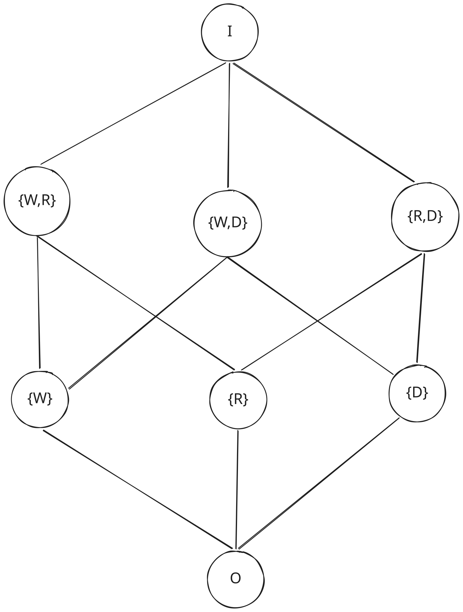

# Sistema de Permisos basado en Álgebra de Boole y Bitmask

Este proyecto implementa un sistema de control de acceso y gestión de permisos fundamentado en los principios formales del **Álgebra de Boole** y la **Teoría de Retículas (Lattices)**, ejecutado a bajo nivel mediante operaciones a nivel de bits (*bitmasking*).

---

## 1. Fundamentos Teóricos: El Álgebra de Boole en Permisos

Un Álgebra de Boole es una estructura algebraica $(B, \vee, \wedge, \neg, O, I)$ definida sobre un conjunto no vacío $B$, dotada de dos operaciones binarias cerradas y una operación unaria, junto con dos elementos distinguidos: el elemento nulo ($O$) y el elemento universal ($I$).

En un sistema de permisos, cada permiso atómico representa un elemento generador (átomo de la retícula), y cualquier combinación de permisos es un elemento derivado dentro del álgebra.

### Operadores Básicos

| Operación Formal | Operador Booleano | Símbolo de Retícula | Operador en Código | Bitwise Equivalente | Significado en Permisos |
| :--- | :---: | :---: | :---: | :---: | :--- |
| **Mínima Cota Superior (Supremo / Join)** | $+$ | $\vee$ *(sombrero hacia abajo)* | `+` | `\|` (OR) | **Añadir / Combinar permisos** |
| **Máxima Cota Inferior (Ínfimo / Meet)** | $*$ | $\wedge$ *(sombrero hacia arriba)* | `*` | `&` (AND) | **Intersección / Verificar pertenencia** |
| **Complemento Absoluto (Negación)** | $\neg$ | $\neg$ *(o $\sim$)* | `~` | `~` (NOT) | **Inversión / Exclusión de permisos** |

> **Nota Teórica:** En la teoría de conjuntos y retículas:
> - $\vee$ (*join* o sombrero hacia abajo) encuentra la **mínima cota superior**, reuniendo todos los privilegios presentes en ambos conjuntos.
> - $\wedge$ (*meet* o sombrero hacia arriba) encuentra la **máxima cota inferior**, aislando únicamente los privilegios compartidos de manera simultánea.

---

## 2. Diagramas de Hasse de la Retícula de Permisos

El orden parcial inducido por la inclusión de permisos ($\subseteq$ o relación de orden booleano $\le$) puede representarse geométricamente mediante un **Diagrama de Hasse**. En la carpeta [docs](file:///home/red-mat/Proyectos/bin-auth/docs) se encuentran los diagramas vectoriales para entornos claros y oscuros:

### Visualización de la Retícula

<p align="center">
  <picture>
    <source media="(prefers-color-scheme: dark)" srcset="docs/hasse-dark.svg">
    <source media="(prefers-color-scheme: light)" srcset="docs/heasse.svg">
    
  </picture>
</p>

### Estructura de la Retícula Representada:
- **Cota Inferior Universal ($O$):** Base de la retícula, representa la ausencia total de permisos (`000`).
- **Nivel 1 (Átomos):** Permisos primitivos individuales: $\{W\}$, $\{R\}$, $\{D\}$.
- **Nivel 2 (Subconjuntos / Combinaciones binarias):** Permisos combinados: $\{W, R\}$, $\{W, D\}$, $\{R, D\}$.
- **Cota Superior Universal ($I$):** Vértice superior, representa el universo completo de privilegios (`111` / `1111`).

---

## 3. Tabla de Equivalencia

A continuación se detalla la correspondencia entre los estados de la retícula, su notación teórica y su representación binaria:

| Símbolo | Notación de Conjunto | Representación Binaria | Descripción |
| :---: | :---: | :---: | :--- |
| **$O$** | $\emptyset$ | `000` | Conjunto vacío (Ningún permiso asignado) |
| **$W$** | $\{W\}$ | `001` | Átomo: Permiso de Escritura (*Write*) |
| **$R$** | $\{R\}$ | `010` | Átomo: Permiso de Lectura (*Read*) |
| **$D$** | $\{D\}$ | `100` | Átomo: Permiso de Eliminación (*Delete*) |
| **$W \vee R$** | $\{W, R\}$ | `011` | Lectura y Escritura |
| **$W \vee D$** | $\{W, D\}$ | `101` | Escritura y Eliminación |
| **$R \vee D$** | $\{R, D\}$ | `110` | Lectura y Eliminación |
| **$I$** | $\{W, R, D\}$ o Universo | `1111` *(o `111` en $B_3$)* | Elemento universal (Todos los permisos activos) |

---

## 4. Aclaración: Implementación de Código vs. Modelo Teórico (CRUD en 64 bits)

Mientras que el diagrama teórico de la retícula $B_3$ utiliza 3 átomos representativos ($\{W, R, D\}$) para ilustrar de forma didáctica un cubo booleano tridimensional, en el código fuente de este repositorio se desarrolló una arquitectura orientada a recursos empresariales bajo el modelo **CRUD** (*Create, Read, Update, Delete*):

En [`permissions.py`](file:///home/red-mat/Proyectos/bin-auth/permissions/permissions.py), la clase [`Permissions`](file:///home/red-mat/Proyectos/bin-auth/permissions/permissions.py#L5-L47) y el tipo [`Mask`](file:///home/red-mat/Proyectos/bin-auth/permissions/bitmask.py#L1-L16) gestionan palabras de **64 bits**:

```python
Create = Mask(1 << 0)  # 0b0001 (Bit 0)
Read   = Mask(1 << 1)  # 0b0010 (Bit 1)
Update = Mask(1 << 2)  # 0b0100 (Bit 2)
Delete = Mask(1 << 3)  # 0b1000 (Bit 3)

Empty  = O             # 0x0000000000000000 (64 ceros)
Full   = I             # 0xFFFFFFFFFFFFFFFF (64 unos)
```

Esto extiende la retícula a $2^4 = 16$ combinaciones base para el espacio CRUD y permite escalar hasta $2^{64}$ estados independientes en el mismo espacio numérico.

---

## 5. Casos de Uso Fundamentales

### 1. Añadir Permiso (Unión / Supremo $\vee$)
Para otorgar uno o varios permisos a un usuario, se aplica la **mínima cota superior** (disyunción lógica $\vee$, representada por la suma booleana $+$):

$$P_{\text{nuevo}} = P_{\text{actual}} \vee P_{\text{otorgar}}$$

```python
# Añadir permiso de eliminación
user = user + eliminacion
```

### 2. Quitar Permiso (Intersección con Complemento $\wedge \neg$)
Para revocar un permiso, se intersecta el conjunto actual con el **complemento** del permiso a eliminar mediante la **máxima cota inferior** ($\wedge$, representada por el producto booleano $*$):

$$P_{\text{nuevo}} = P_{\text{actual}} \wedge \neg P_{\text{revocar}}$$

```python
# Quitar permiso de eliminación
user = user * ~eliminacion

# Quitar múltiples permisos a la vez mediante De Morgan: user ∧ ¬(C ∨ D)
user = user * ~(creacion + eliminacion)
```

### 3. Verificar Permiso (Contención en la Retícula)
En un orden parcial booleano, un usuario $P$ posee el permiso $Q$ si y solo si $Q$ es una cota inferior de $P$, lo cual se expresa formalmente como:

$$P \wedge Q = Q \quad \iff \quad Q \le P$$

```python
def eliminar_recurso(p: Permissions, recurso: str):
    # Verifica si el permiso 'eliminacion' está contenido en 'p'
    if p * eliminacion == eliminacion:
        print("U: elimino", recurso)
    else:
        print("U: No tiene los permisos para eliminar", recurso)
```

---

## 6. Apartado Especial: *Syntax Sugar* del Operador Resta (`-`)

En el Álgebra de Boole formal $(B, \vee, \wedge, \neg, O, I)$, la resta aritmética no existe como operador primitivo. Sin embargo, en teoría de conjuntos se define la **diferencia de conjuntos** ($A \setminus B$ o $A - B$), equivalente a los elementos de $A$ que no pertenecen a $B$:

$$A - B \equiv A \wedge \neg B$$

Para simplificar la ergonomía del lenguaje y hacer el código más declarativo y legible, en la clase [`Permissions`](file:///home/red-mat/Proyectos/bin-auth/permissions/permissions.py#L42-L44) se sobrecargó el operador `-` como **azúcar sintáctico (*syntax sugar*)**:

```python
def __sub__(self, otro: Permissions) -> Permissions:
    """Syntax sugar para la revocación de permisos: A - B == A * ~B"""
    return self * ~otro
```

### Uso en código:
En lugar de escribir expresiones complejas con complementos e inversiones:
```python
# Sin syntax sugar (Operadores booleanos canónicos):
user = user * ~(creacion + eliminacion)

# Con syntax sugar (Legible y secuencial):
user = user - creacion - eliminacion
```

---

## 7. Ventajas: Representación Binaria vs. Arreglo de Strings

Tradicionalmente, muchos sistemas almacenan listas de permisos como cadenas de texto (ej. `['read', 'write', 'delete']`). El enfoque booleano con máscaras binarias ofrece ventajas sustanciales:

| Criterio | Arreglo de Strings (`list[str]`) | Álgebra de Boole / Bitmask (`int` / `Mask`) |
| :--- | :--- | :--- |
| **Rendimiento CPU** | $O(N)$ tiempo de búsqueda lineal o $O(1)$ amortizado con sets/hash tables. Comparación de strings caracter por caracter. | **$O(1)$ en un ciclo de instrucción de CPU**. Operaciones directas en registros del procesador (`AND`, `OR`, `NOT`). |
| **Uso de Memoria** | Alto consumo. Cada string requiere memoria para el objeto en heap, codificación UTF-8, apuntadores de lista y overhead del recolector de basura. | **Extremadamente compacto**. 64 permisos completos caben en un único entero de 8 bytes (64 bits). |
| **Almacenamiento en DB** | Tablas intermedias de muchos a muchos (`user_permissions`), columnas `JSON` o campos `VARCHAR` que requieren índices pesados. | **Una sola columna `BIGINT`** o `INTEGER`. Índices ultra rápidos y búsquedas masivas mediante operadores bitwise SQL (`WHERE permissions & 4 = 4`). |
| **Transmisión y Red** | Payloads JSON grandes en tokens JWT o respuestas HTTP. | Un único número entero o hexadecimal en headers o tokens (reduciendo drásticamente el ancho de banda). |
| **Integridad y Errores** | Vulnerable a errores tipográficos (`"reed"` en vez de `"read"`), diferencias de mayúsculas/minúsculas y validaciones en tiempo de ejecución. | Errores atrapados por constantes formales o tipos en tiempo de compilación/diseño. Imposibilidad de duplicados por idempotencia ($A \vee A = A$). |

---

## 8. Casos de Estudio: Sistemas Reales en Producción

El uso de Álgebra de Boole y máscaras de bits no es solo un modelo teórico; constituye el **estándar industrial de facto** en infraestructuras de misión crítica donde el rendimiento y la atomicidad son indispensables:

### 1. API de Discord (Plataformas Web y Cloud Masivas)
Discord administra los privilegios de servidores, roles y canales mediante un **bitfield de 64 bits** (`BigInt`).
- **Implementación:** Cada permiso atómico corresponde a un desplazamiento binario (`1n << 0n` para `CREATE_INSTANT_INVITE`, `1n << 3n` para `ADMINISTRATOR`, etc.).
- **Álgebra booleana en roles:** Los permisos finales de un canal combinan los roles base mediante el supremo ($\vee$) y aplican sobreescrituras explícitas de denegación (`deny`) y concesión (`allow`) mediante la intersección con el complemento ($\wedge \neg$):
  $$\text{PermisosFinales} = (\text{RolesBase} \wedge \neg \text{DenyOverwrites}) \vee \text{AllowOverwrites}$$
- **Detalle de producción:** En sus respuestas JSON, Discord serializa estos números como cadenas (`"1071698660929"`) para evitar que clientes web en JavaScript con enteros de punto flotante IEEE 754 de 53 bits desborden el valor.

### 2. Kernel de Linux y Sistemas de Archivos POSIX (`chmod` / inodos)
El estándar de permisos de Linux/Unix almacena los privilegios de cada archivo en el campo `st_mode` (`stat.h`) del inodo.
- **Implementación:** 12 bits dedicados a permisos (`rwx` para Usuario, Grupo y Otros, más bits especiales SetUID, SetGID y Sticky Bit):
  - Lectura ($R$): `0b100` (4 en octal)
  - Escritura ($W$): `0b010` (2 en octal)
  - Ejecución ($X$): `0b001` (1 en octal)
- **Evaluación en VFS:** Cada llamada al sistema (`open`, `read`, `write`) verifica el acceso en **un único ciclo de reloj**:
  ```c
  if ((inode->i_mode & mask) == mask)
  ```

### 3. Microsoft Windows NT Kernel (`ACCESS_MASK` y DACLs)
El subsistema de seguridad de Windows administra el acceso a cualquier objeto del sistema operativo (archivos NTFS, llaves del registro, procesos) mediante un `DWORD` de 32 bits denominado `ACCESS_MASK` en `winnt.h`.
- **Segmentación:**
  - **Bits 0–15:** Derechos específicos del objeto (ej. `FILE_READ_DATA = 0x0001`).
  - **Bits 16–23:** Derechos estándar compartidos (ej. `DELETE = 0x00010000`, `WRITE_DAC = 0x00040000`).
  - **Bits 28–31:** Macros de derechos genéricos (`GENERIC_READ = 0x80000000`, `GENERIC_ALL = 0x10000000`).
- **Evaluación en el SRM:** El *Security Reference Monitor* del kernel de Windows valida los tokens de acceso frente a las listas de control discrecional (DACL) evaluando las máscaras mediante operaciones lógicas bit a bit.

### 4. Motor Interno de PostgreSQL (`AclMode` en `acl.h`)
En la base de datos relacional PostgreSQL, el control de acceso a tablas, vistas y secuencias (`GRANT SELECT, INSERT...`) no se verifica mediante cadenas de texto en tiempo de consulta.
- **Implementación:** En el código fuente ([`src/include/utils/acl.h`](https://github.com/postgres/postgres/blob/master/src/include/utils/acl.h)), los permisos son un entero de 32 bits denominado `AclMode`:
  ```c
  #define ACL_INSERT    (1<<0)  /* a: append */
  #define ACL_SELECT    (1<<1)  /* r: read */
  #define ACL_UPDATE    (1<<2)  /* w: write */
  #define ACL_DELETE    (1<<3)  /* d: delete */
  #define ACL_TRUNCATE  (1<<4)  /* D: truncate */
  ```
- **Persistencia y verificación:** La columna `relacl` de la tabla de catálogo `pg_class` almacena arreglos de `aclitem` con estos bitmasks. Durante la ejecución de cualquier consulta SQL, `pg_attribute_aclcheck` valida la autorización en memoria con una simple operación bitwise `&`.

### 5. Listas de Control de Acceso (ACL) en Redis 6+
Redis es un almacén en memoria clave-valor diseñado para procesar cientos de miles de operaciones por segundo en un único hilo.
- **Implementación:** En `acl.c`, los comandos se clasifican en categorías representadas por máscaras de 64 bits (`uint64_t`), tales como `ACL_CATEGORY_READ = (1ULL << 1)` o `ACL_CATEGORY_DANGEROUS = (1ULL << 5)`.
- **Validación instantánea:** Al recibir un comando, Redis comprueba de inmediato si la categoría está contenida en la máscara del usuario conectado con una operación `AND` a nivel de registro de CPU, sin sobrecostos de latencia.

---

## 9. Limitaciones

A pesar de sus ventajas, el modelo presenta limitaciones inherentes que deben evaluarse:

1. **Límite Físico de Bits:**
   - La cantidad de permisos directos está acotada al ancho de palabra elegido (ej. 32 bits = 32 permisos, 64 bits = 64 permisos). Superar este límite requiere estructuras compuestas (`BitArray` o `BigInt`), lo que aumenta la complejidad.
2. **Opacidad y Dificultad de Depuración:**
   - Para un desarrollador o auditor, el valor numérico `0x0000000A` o `0b1010` no es auto-descriptivo a simple vista en logs sin una función de traducción que proyecte los bits a etiquetas humanas.
3. **Dinamismo en Tiempo de Ejecución:**
   - Asignar permisos nuevos definidos dinámicamente por un usuario final desde un panel de administración en caliente requiere gestionar la asignación de posiciones de bits libres y migraciones de esquemas numéricos.
4. **No Soporta Contextos Complejos por sí solo (ABAC):**
   - Resuelve eficientemente la presencia o ausencia de privilegios (RBAC), pero no puede evaluar por sí mismo atributos dinámicos como "permitir acceso solo de 9:00 a 18:00" o "solo si el usuario es propietario del recurso".

---

## 10. Aspectos a Tener en Cuenta

1. **Precedencia de Operadores en el Lenguaje:**
   - En Python y otros lenguajes, los operadores a nivel de bits (`&`, `|`, `^`) tienen **menor precedencia** que los operadores de comparación (`==`, `!=`). Escribir `p & Read == Read` se evaluaría como `p & (Read == Read)`.
   - Al sobrecargar los operadores aritméticos `*` y `+` para representar $\wedge$ y $\vee$, la precedencia matemática estándar preserva el orden intuitivo, aunque siempre es una buena práctica aislar expresiones complejas con paréntesis.
2. **Enteros de Precisión Arbitraria y Complemento a Dos:**
   - En Python, los enteros no tienen un tamaño fijo de 32 o 64 bits, sino que crecen dinámicamente. Al aplicar el operador `~` (*NOT*), Python genera números negativos según el complemento a dos (`~x = -x - 1`).
   - Por esta razón, en [`bitmask.py`](file:///home/red-mat/Proyectos/bin-auth/permissions/bitmask.py#L4) es fundamental aplicar una máscara acotada al universo:
     ```python
     self.valor = valor & 0xFFFFFFFFFFFFFFFF
     ```
3. **Inmutabilidad y Versionado de Bits:**
   - Las posiciones de los bits asignados a cada permiso (`1 << 0`, `1 << 1`, etc.) **nunca deben cambiar una vez persistidos datos en producción**, ya que alterar el orden de un bit corrompería todos los permisos almacenados previamente en la base de datos.
4. **Comprobación de Máscara Completa vs. Máscara Parcial:**
   - Para comprobar un único permiso, evaluar `(user * P) == P` o `(user._mask.valor & P.valor) != 0` es equivalente.
   - Sin embargo, para comprobar un conjunto compuesto de permisos requeridos simultáneamente (ej. verificar si el usuario tiene `Lectura` Y `Escritura`), la fórmula matemática correcta siempre debe ser:
     $$(P_{\text{usuario}} \wedge P_{\text{requeridos}}) = P_{\text{requeridos}}$$
     Garantizando que **todos** los bits solicitados estén presentes en el conjunto.

---

## 11. Ejecución del Proyecto

Para probar el flujo completo y los casos de uso documentados, ejecute el script principal [app.py](file:///home/red-mat/Proyectos/bin-auth/app.py):

```bash
python3 app.py
```
